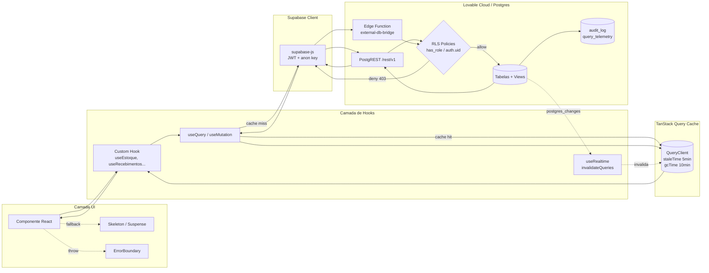
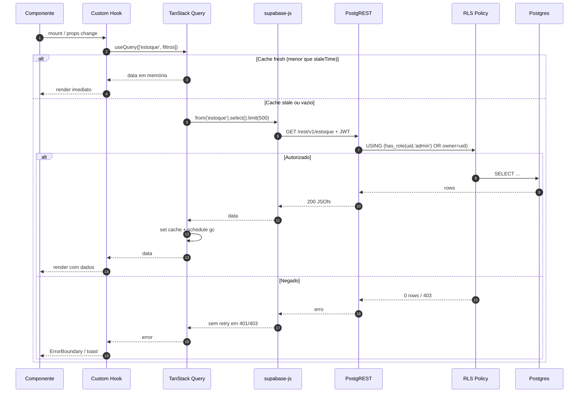
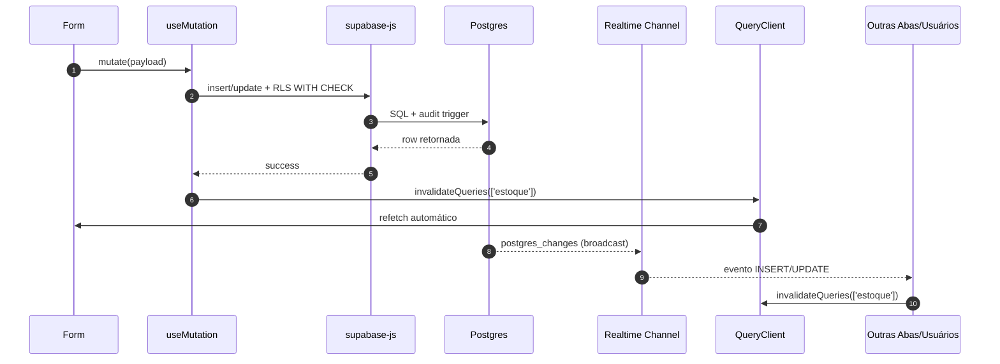
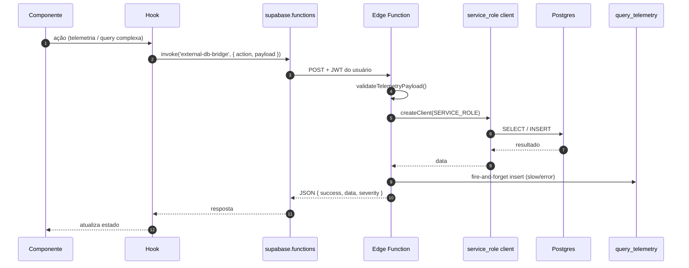
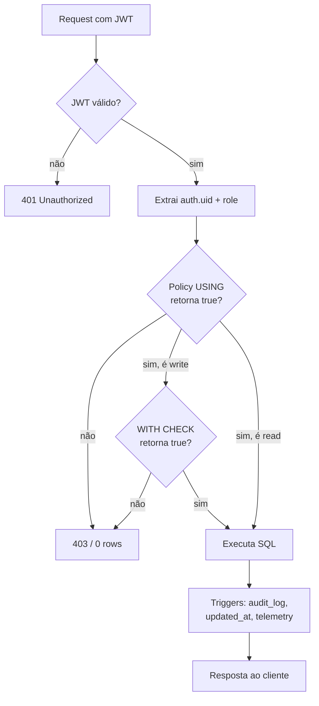

# Arquitetura Técnica - ESTOKI

Este documento descreve a arquitetura do sistema WMS ESTOKI: fluxo de dados ponta a ponta, organização de pastas e contratos de integração.

## 🔄 Fluxo de Dados Completo

### Visão em Camadas (UI → Hook → Supabase → RLS → Cache)



### Sequência de uma Leitura Autenticada



### Sequência de uma Mutação com Invalidação + Realtime



### Fluxo via Edge Function (`external-db-bridge`)



### Avaliação de RLS (detalhe)



---

## 📁 Mapa do Projeto e Responsabilidades

Estrutura inspirada em Clean Architecture adaptada para Vite + Serverless.

### Frontend (`src/`)

| Camada        | Responsabilidade                               | Exemplo                          |
| ------------- | ---------------------------------------------- | -------------------------------- |
| `components/` | Componentes de UI puros e reutilizáveis.       | `Button.tsx`, `DataTable.tsx`    |
| `hooks/`      | Orquestração de estado e chamadas assíncronas. | `useRealtime.ts`, `useCRUD.ts`   |
| `features/`   | Domínios verticais (hooks + pages + services). | `features/inventory`, `shipping` |
| `pages/`      | Composição de componentes para formar telas.   | `Dashboard.tsx`, `Estoque.tsx`   |
| `services/`   | Acesso a dados e regras de domínio.            | `authService.ts`                 |
| `lib/`        | Utilitários puros sem efeitos colaterais.      | `logger.ts`, `cn.ts`             |
| `types/`      | Contratos de interface e tipos do banco.       | `database.types.ts`              |

### Backend (`supabase/`)

| Camada        | Responsabilidade                                |
| ------------- | ----------------------------------------------- |
| `functions/`  | Lógica de servidor segura (Edge Functions).     |
| `migrations/` | Definição de tabelas, triggers e Políticas RLS. |

---

## 🌉 Contratos da Edge Function: `external-db-bridge`

Proxy seguro para telemetria e consultas auditadas.

### Endpoint: `POST /external-db-bridge`

#### Request Body

```json
{
  "action": "emit_telemetry | query_telemetry | cleanup_telemetry",
  "payload": { "operation": "string", "duration_ms": 0 }
}
```

#### Response (Sucesso)

```json
{
  "success": true,
  "severity": "normal | slow | very_slow | error",
  "persisted": true
}
```

#### Erros Padronizados

| Código | Motivo                                    |
| ------ | ----------------------------------------- |
| `400`  | Payload inválido ou ação não reconhecida. |
| `401`  | Token JWT inválido ou expirado.           |
| `403`  | Violação de Política RLS.                 |
| `500`  | Falha interna na execução.                |

---

## 🛠️ Padrões de Desenvolvimento

1. **Segurança (RLS):** todas as tabelas públicas com RLS habilitado e GRANT explícito.
2. **Performance:** cache agressivo com TanStack Query, `limit(500)` em queries genéricas.
3. **Auditabilidade:** triggers para `audit_log` e telemetria slow/error em `query_telemetry`.
4. **Testabilidade:** Vitest (unit) + Playwright (E2E) bloqueando merges no CI.

---

## 🧪 Estratégia de Testes

### E2E (`tests/e2e/`)

Playwright cobre login/logout, rotas protegidas, persistência de sessão e fluxos críticos. Relatórios HTML + traces publicados como artifacts no GitHub Actions.

### Unitários e Integração

Vitest + React Testing Library próximos aos componentes (`__tests__/`).

```bash
npm run test       # unitários
npm run test:e2e   # ponta a ponta
```
