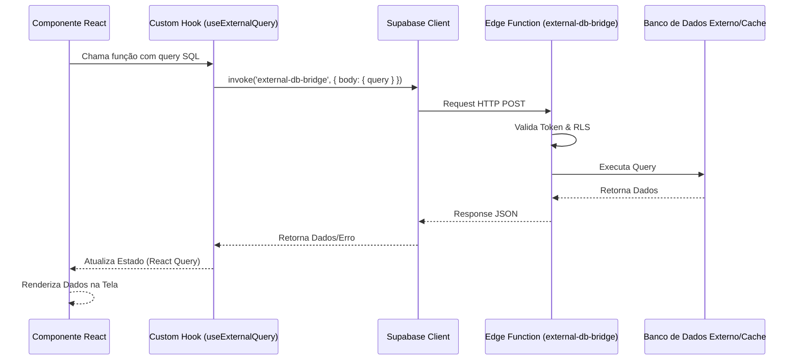

# Arquitetura Técnica - ESTOKI

Este documento descreve a arquitetura do sistema WMS ESTOKI, detalhando o fluxo de dados, a organização de pastas e os contratos de integração.

## 🔄 Fluxo de Dados (Diagrama de Sequência)

O sistema utiliza uma ponte segura entre o frontend e fontes de dados externas ou protegidas via Supabase Edge Functions.



---

## 📁 Mapa do Projeto e Responsabilidades

A estrutura segue o padrão de **Clean Architecture** adaptado para ambientes Serverless/Vite.

### Frontend (`src/`)

| Camada        | Responsabilidade                               | Exemplo                          |
| ------------- | ---------------------------------------------- | -------------------------------- |
| `components/` | Componentes de UI puros e reutilizáveis.       | `Button.tsx`, `DataTable.tsx`    |
| `hooks/`      | Orquestração de estado e chamadas assíncronas. | `useExternalQuery.ts`            |
| `pages/`      | Composição de componentes para formar telas.   | `Dashboard.tsx`, `Inventory.tsx` |
| `services/`   | Configuração de clientes (Supabase, API).      | `supabase.ts`                    |
| `lib/`        | Funções utilitárias sem efeitos colaterais.    | `logger.ts`, `cn.ts`             |
| `types/`      | Contratos de interface e tipos do banco.       | `database.types.ts`              |

### Backend (`supabase/`)

| Camada        | Responsabilidade                                |
| ------------- | ----------------------------------------------- |
| `functions/`  | Lógica de servidor segura (Edge Functions).     |
| `migrations/` | Definição de tabelas, triggers e Políticas RLS. |

---

## 🌉 Contratos da Edge Function: `external-db-bridge`

A Edge Function atua como um Proxy seguro para consultas complexas e auditoria.

### Endpoint: `POST /external-db-bridge`

#### Request Body

```json
{
  "query": "string",
  "params": "array (opcional)"
}
```

#### Response (Sucesso)

```json
{
  "data": "array",
  "execution_time_ms": "number",
  "error": null
}
```

#### Erros Padronizados

| Código | Motivo                                                   |
| ------ | -------------------------------------------------------- |
| `401`  | Token JWT inválido ou expirado.                          |
| `403`  | Violação de Política RLS (Tentativa de acesso proibido). |
| `400`  | Query SQL malformada ou parâmetro inválido.              |

---

## 🛠️ Padrões de Desenvolvimento

1.  **Segurança (RLS):** Nunca confie no frontend. Todas as tabelas possuem RLS habilitado.
2.  **Performance:** Uso agressivo de `React Query` para cache de consultas.
3.  **Auditabilidade:** Toda operação via `external-db-bridge` gera um log na tabela `audit_log`.
